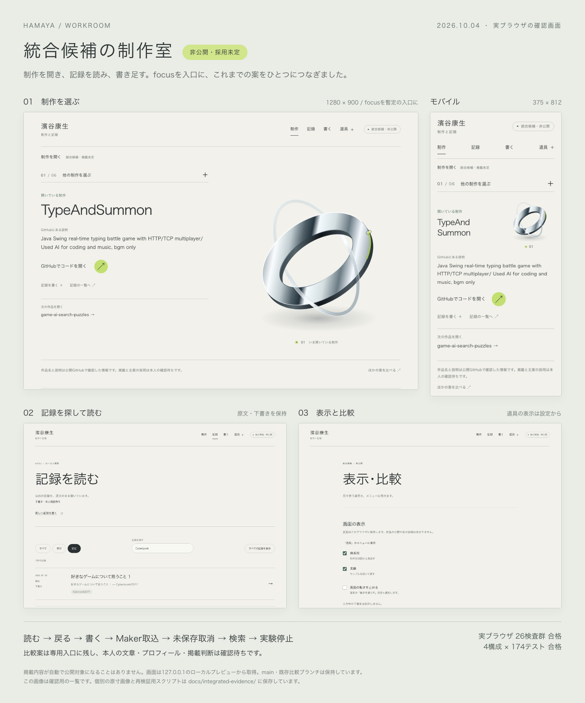

# 統合候補の制作室

本人が「これを基に進める／ここを変える」を判断するための、非公開の統合候補です。`japanese-ui-copy` の `c0a2580` を基点にした `integrated-workroom` ブランチで制作しています。既存のmain・比較ブランチ・プレビューは保持し、公開・デプロイ・採用確定はしていません。

## ひとつの入口から使う

入口は、ひとつの制作を選んで読むfocusです。主ナビは「制作」「記録」「書く」と「道具」に絞りました。道具には時系列、Makerの制作ログ、実験、作品候補、自己紹介、表示・比較をまとめています。

記録では、既存の本人記事を原文のまま読んで検索できます。下書き・本人確認待ちと明示し、通常の公開用一覧とは分けています。新しく書いたものや取り込んだものが自動で掲載されることはありません。

| 接続したもの | 統合候補での扱い                                                                                                                                |
| ------------ | ----------------------------------------------------------------------------------------------------------------------------------------------- |
| focus        | 暫定のホーム。従来の6件の確認済み公開GitHub情報のみを表示。作者・制作期間・記事との関係は足さない。                                             |
| 読む・検索   | 本人の旧記事1件を明示した対象リストから読み込む。題・要約・タグを検索し、本文から一覧へ戻ると検索条件を保つ。原文と `draft: true` を保持。      |
| 書く         | 確認とダウンロードを分離。未ダウンロードの入力がある場合は、ブラウザの移動確認でその場に残れる。自動保存なし。                                  |
| Maker        | 別タブでJSONを読み、1件のMarkdown下書きをダウンロード。Writerへは本人がファイルを選んで取り込む。記録ごとの未ダウンロード入力も移動確認の対象。 |
| 時系列       | コミット日時（UTC）と本人入力の制作日を区別したまま、道具から開く。                                                                             |
| 実験         | 開いてから操作すると動く。停止・再開・終了を維持。「シドの試作（AI）」と本人の実績を区別する。                                                  |
| 表示設定     | 時系列・実験をメニューに出すか、装飾の動きを止めるかだけを保存。採用・公開判断は変えない。非表示の道具も設定画面から開ける。                    |

## 比較用として残したもの

棚から選ぶcollection、従来のfocus、最初のホーム本文、光・軌道・紙面・場・制作机の5つの見た目は「表示・比較」から開きます。主画面にすべてを並べず、本人が比べたいときに見られるようにしました。どの案も却下・削除していません。

作品9候補の選択は一時的なチェックのままです。チェック、表示設定、ファイルのダウンロードは、掲載や公開の決定を意味しません。自己紹介・写真・本人の制作日・AtCoder URL・掲載する内容は、引き続き本人の確認待ちです。

## 統合時の判断

基点には静的安全性の修正、軽量化、実験、作品候補、Maker、時系列、日本語UIの各変更がすでに含まれています。祖先関係を確認し、同じ変更を重複して取り込まず、導線と境界を新しく接続しました。

- `LOCAL_WORKROOM=1` の明示指定だけで統合候補を生成します。通常buildは従来の公開用ページだけです。統合モードではcanonicalも出力しません。
- 私用記事の対象は `workroom-notes.mjs` に明示した旧記事1件だけです。新しいファイルやサンプル、別の記事が自動で対象に加わることはありません。作品との関連も推測していません。関連する公開記事のリンクは、従来の公開用経路を維持しています。
- 未保存確認は保存機能ではありません。本文の保存や送信を加えず、ページを移るときだけブラウザに確認を求めます。確認の表示はブラウザに依存します。ダウンロード開始後はその時点の入力を受け渡し済みとして扱いますが、端末への保存完了を保証するものではありません。
- 表示設定はバージョンと2つの真偽値、動きの設定だけです。本文・検索語・取り込んだJSONを保存しません。保存できない環境では、その画面内だけ変更を反映します。
- 同じタブへの動きの通知は、変更した値を渡します。保存に失敗したとき、古い保存値を再読込して停止操作を取り消す問題をレビューで見つけ、この方式で修正しました。

移動確認のブラウザ依存性と、未保存時だけリスナーを登録する方針は [MDNのbeforeunload説明](https://developer.mozilla.org/en-US/docs/Web/API/Window/beforeunload_event) も確認しています。古い実装向けの `returnValue` を併用するため、Astroの静的確認には非推奨APIのヒントが1件出ます。自動保存で補う変更は加えていません。

## ローカルで確認する

```sh
ASTRO_TELEMETRY_DISABLED=1 BASE_PATH=/hamaya-site-draft LOCAL_WORKROOM=1 npm run build
BASE_PATH=/hamaya-site-draft LOCAL_WORKROOM=1 npm test
```

生成した `dist/` をローカルサーバーの `/hamaya-site-draft/` 配下へ置き、127.0.0.1だけで待ち受けます。この作業では `http://127.0.0.1:4360/hamaya-site-draft/` を使用します。

主な入口は `room/notes/`、`write/`、`write/maker-field/`、`room/settings/`、`room/compare/` です。通常の `npm run build` ではこれらのローカル専用ページを配布しません。

編集しながら確認する場合は `BASE_PATH=/hamaya-site-draft npm run dev:workroom` を使えます。4361番ポートで127.0.0.1だけに開き、検証済みの4360番プレビューは保持します。

## 検証記録

2026年10月4日に確認しました。本人の理解度・好みを測ったものではなく、採用判断は未確認です。

| 構成                             | 出力ページ |    テスト |
| -------------------------------- | ---------: | --------: |
| 通常・ルート配信                 |          5 | 174件合格 |
| 通常・`/hamaya-site-draft/` 配信 |          5 | 174件合格 |
| 従来の比較・同base path          |         18 | 174件合格 |
| 統合候補・同base path            |         23 | 174件合格 |

`npm run lint` はエラー0、警告0。前述の互換用APIに関するヒント1件が残ります。`git diff --check` も通っています。本人の記事・データ・自己紹介など15ファイルはSHA256で基点と一致し、既存9作業領域は同じコミットで変更なしです。祖先関係と保持の結果は [checks.json](integrated-evidence/checks.json)、[inherited-heads.json](integrated-evidence/inherited-heads.json) に保存しています。

Chromium 153.0.8010.12で本筋19群、設定保存失敗2群、修正後の限定確認5群、計26検査群が合格しました。

- 制作を選ぶ → 記録を読む → 戻る → 記録を書く → Makerを別タブで開く → Markdownを取り込む → 取り込み取消 → 未保存離脱取消 → 検索 → 実験停止を横断確認。
- 合成のMaker下書きをWriterへ渡し、685 bytesの再ダウンロードがSHA256まで一致。`draft: true` を保持。取り込み取消と実際のブラウザ移動確認の取消で入力が残ることを確認。
- ダウンロード直後は移動確認なし。再編集すると再び確認対象になり、取消で残り、了承すると移動。Makerも同様。
- 1280・375・320px、キーボード、JavaScript無効、reduced-motion、別タブとの設定同期、検索結果なしと解除、比較導線を確認。
- 設定保存が失敗してもページ内の表示変更と停止状態を保持。ページ・コンソールエラー、外部リクエスト、POST、本文・JSONのstorage保存は観測なし。書き込みは表示設定のみ。

証跡は [本筋](integrated-evidence/browser-evidence.json)、[保存失敗](integrated-evidence/preference-failure-evidence.json)、[最終確認](integrated-evidence/final-smoke-evidence.json) です。画面内の入力テストは合成データで、本人の新しい文章ではありません。

最終ホームの応答本文はHTML 32,783 bytes、外部CSS・JS 36,631 bytes、合計69,414 bytes。既存focusの58,663 bytesに対し10,751 bytes増えています。これは非圧縮の応答本文サイズで、通信速度や体感性能を測った値ではありません。外部JSは計2,239 bytesで、ホームにはMakerのパーサーや実験用コードを読み込みません。最新値は `final-smoke-evidence.json` を正本とします。

## 確認用画像と再実行



一覧画像はLibraryにも保存済みです。

- Library ID: `libfile_77792c7f02d881918a0a70edd3e191e8`
- File ID: `file_00000000f4f88206907e6652e4f33f33`
- [原寸の画面・報告・再実行スクリプト](integrated-evidence/README.md)

本人確認として残っているのは、focusを採るか、掲載する作品・記事、自己紹介と写真、制作日、AtCoder URLです。機能面で保存を妨げる未解決の問題はありません。未保存確認のブラウザ依存性と、自動保存を行わない制約は引き続きあります。

## QAサーバーの整理

横断検証の完了後、本人からの整理指示に従い、この制作作業で起動した旧QAサーバーだけを終了しました。PID・コマンド・配信元を照合し、SIGTERM後に待受がなくなったことを確認しています。ソース、配信済みの静的ファイル、画像、検証結果は削除していません。

- 停止: collection 4334、focus 4338、監査版4344、実験4345、作品候補4346、使い心地4351、Maker4354、時系列4355、日本語UIの変更前4357・変更後4358。
- 維持: 統合候補4360。元のプレビュー4321、別タスクや所有不明のプロセスは操作していません。
- 比較ガイド4347は、この統合ブランチのガイドへ再起動しました。古い画像は保持し、試用リンクは4360の対応画面を開きます。
- 今回のQA専用Playwright runtime/profileに該当する残存ブラウザプロセスはありませんでした。本人のブラウザやタブは操作していません。

具体的なPIDと配信元は [runtime-cleanup.json](integrated-evidence/runtime-cleanup.json) に保存しています。メモリ圧力・CPU・swapや整理による削減量は測定しておらず、負荷の診断はしていません。

ガイド更新後、ガイドのテスト4件と全体175件が合格しました。実ブラウザでは統合候補へ進む9リンクのHTTP 200、1280・375・320pxでの表示、ページエラー0を確認しています。[追加確認の記録](integrated-evidence/guide-current-evidence.json) と [現在のガイド画面](integrated-evidence/guide-current-1280.png) も保存しました。検証後の専用ブラウザは閉じています。

現在の統合プレビューが終了した場合は、未使用ポートであることを確認したうえで、タスクの作業フォルダから保存済みの静的ファイルを配信できます。

```sh
cd /Users/hamayakousei/Documents/Codex/2026-10-04/task-3
python3 -m http.server 4360 --bind 127.0.0.1 --directory .dot/integrated-qa/preview
```

画像比較ガイドだけを再開する場合:

```sh
cd /Users/hamayakousei/Documents/Codex/2026-10-04/task-3/.dot/site-integrated
npm run guide
```

以後編集する場合は前述の `dev:workroom` を使用できます。静的ファイルが手元にない別端末では、このprivateブランチを取得して依存を導入し、`ASTRO_TELEMETRY_DISABLED=1 BASE_PATH=/hamaya-site-draft npm run dev:workroom` を実行してください。

横断QAの再実行でだけ必要な旧focus比較元4358は、タスクの作業フォルダから `python3 -m http.server 4358 --bind 127.0.0.1 --directory .dot/ui-copy-qa/after` で再開できます。通常の利用には不要です。ほかの旧版もJSONに残した配信元から必要なものだけを起動し、既存のdistやbranchを上書きしないでください。
