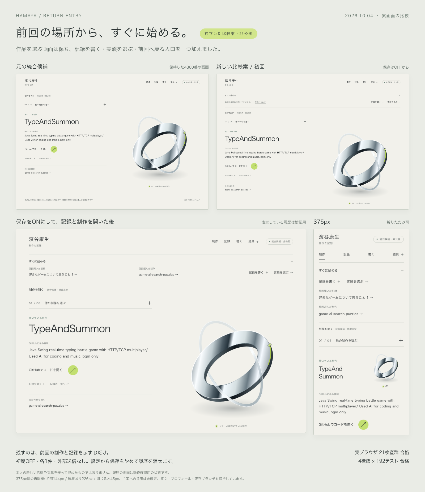

# すぐに始める入口の比較

統合候補 `integrated-workroom` の `ac5bea0` から分けた、小さな比較案です。作業場所は `.dot/site-return`、ブランチは `return-entry`。元の統合候補とmain、既存の比較枝は保持しています。採用・公開・デプロイはしていません。

## 変えたところ

focusの上に「すぐに始める」欄を一つ加えました。「記録を書く」と「実験を選ぶ」は保存設定なしで使えます。確認済み作品のコードを開く導線と、銀の立体はそのままです。主ナビも増やしていません。

前回の場所を残す設定をONにすると、最後に開いた記録と、自分で選んだ制作をそれぞれ1件だけ表示します。戻る先は本人がリンクを押して選びます。ページを開くたびに前回の作品へ自動で切り替えることはしません。欄を閉じると1行にたためます。開閉は保存しません。

初回は保存OFFです。架空の活動や「今日やったこと」は表示しません。ONにする前の操作や、ホームで最初に表示された作品を過去の履歴として取り込みません。実験は静かな選択画面を開くだけで、再生・通知・監視は追加していません。既存設定で実験を隠した場合、この入口も隠します。

## 保存と削除

「表示・比較」→「前回の場所」で保存内容を読み、明示的にONにできます。「保存をやめて履歴を消す」、またはチェックをOFFにすると、専用の保存項目を削除します。表示や動きの既存設定は消しません。

保存するのは `hamaya-workroom-return-v1` という1項目の `{ enabled: true, work: ID または null, note: ID または null }` だけです。作品は確認済みの6件、記録は明示した旧記事1件から選んだIDに限ります。作品名や題は、現在の許可されたページ情報から表示します。保存したURLを開く仕組みにはしていません。

本文、入力中の下書き、検索語、URL、時刻、閲覧回数、操作の列、実験の状態は保存・送信しません。新しい外部通信や自動収集もありません。保存先はブラウザの同じoriginなので、別ポートの元統合候補とは分かれます。

壊れた値や余分な項目がある旧形式は無効として扱います。現在の候補から消えたIDはリンクにせず、空表示へ戻します。表示時に保存内容を書き換えることはありません。別タブや戻る操作でも現在の保存内容を読み直すだけなので、消した履歴を古い画面から復活させません。

保存や削除に失敗したときは成功と表示しません。保存が使えなくても、作品・記録・執筆・実験への普通のリンクは使えます。JavaScript無効時は再開履歴の状態を断定せず、通常の入口を表示します。

## 実装の判断

- ページ全体を作り直さず、入口と保存設定だけを追加しました。制作物の説明・本人の原文・プロフィールは変更していません。
- 記録はページに到着した時、制作は選択リンクを実際に押した時だけ対象にします。初期表示、URLのhash指定、別タブからの通知、戻る復元は作品選択の書き込みにしません。
- 状態更新のたびに保存先を読み直します。他のタブで無効化された後は、古いタブで作品を選んでも再び保存を始めません。
- 通常buildへの除外を維持します。`LOCAL_WORKROOM=1` の独立したローカル比較でだけ追加します。
- Astroでは描画条件だけでスクリプトの出力を防げなかったため、操作コードの登録自体を明示したローカルbuildに限定しました。通常の配布物に保存キーやID一覧が残らないことを検査します。
- 固定IDには作品名と重なる文字列があるため、配布検査では既知IDと完全一致するJavaScript文字列だけを識別します。題名単独、説明、未知ID、通常buildは従来どおり除外検査の対象です。

## ローカルで比べる

- 元の統合候補: `http://127.0.0.1:4360/hamaya-site-draft/`
- 今回の比較案: `http://127.0.0.1:4362/hamaya-site-draft/`
- 保存設定: `http://127.0.0.1:4362/hamaya-site-draft/room/settings/#return-setting`

静的プレビューを再開する場合は、4362が未使用であることを確認し、タスクの作業フォルダから実行します。

```sh
python3 -m http.server 4362 --bind 127.0.0.1 --directory .dot/return-qa/preview
```

保存済みプレビューがない環境では、このprivateブランチの依存を導入したうえで、別の空きポートで開けます。

```sh
ASTRO_TELEMETRY_DISABLED=1 BASE_PATH=/hamaya-site-draft npm run dev:workroom -- --port 4363
```

既存の4360番と4347番は終了・置換していません。この比較のブラウザ検証は専用contextで行い、終了時に閉じます。本人や別タスクのブラウザ・プロセスは操作しません。

## 確認結果

2026年10月4日に確認しました。

| 構成                          | 出力ページ |    テスト |
| ----------------------------- | ---------: | --------: |
| 通常・ルート配信              |          5 | 192件合格 |
| 通常・GitHub Pages用base path |          5 | 192件合格 |
| 従来の比較mode・同base path   |         18 | 192件合格 |
| 今回の再開入口・同base path   |         23 | 192件合格 |

lintはエラー0・警告0、既存の移動確認で使用する互換APIのヒント1件です。差分検査も通過。本人の原文・プロフィール・データ15ファイルはSHA256が一致し、統合版を含む既存10作業領域は同じHEADで変更なしです。

Chromium 153.0.8010.12で本筋17検査群、最終修正後4検査群、計21群が合格しました。

- 初回OFF、明示ON、制作選択、記録到着、ホームの両再開リンク、書く・実験への入口。
- 別タブでの更新、Command＋クリックでの実際の別タブ、現在開いている作品を勝手に切り替えないこと。
- 削除後に古いタブ・戻る操作・遅延したstorage通知から履歴を復活させないこと。
- 古い形式、破損したJSON、余分な項目、消えたID、保存の読取・書込・削除拒否、失敗からの回復。
- 再開欄の開閉、実験の表示OFFとの連動、1280・375・320px、キーボード、reduced-motion、JavaScript無効。
- 外部リクエスト・ページエラー・コンソールエラー0。保存の成功値は許可したIDと有効化設定だけ。本文・検索語・下書きの保存なし。

実際のブラウザの戻る操作は確認しています。BFCacheの復元通知は `persisted: true` のpageshowイベントを合成して補完しており、ブラウザ自身のBFCache稼働を確認したとは主張しません。履歴ありの画像は検証用の状態で、本人の実活動ではありません。元4360番への確認は読み取りだけで、storageの書き込みはありません。

## 画面からの判断

主ナビ・作品の本文・コード導線・銀の立体は維持できました。再開の操作を先に置く分、制作の表示は下へ移ります。

| 375px幅・812px高  | 再開欄の高さ | コード導線の上端 |
| ----------------- | -----------: | ---------------: |
| 元の統合版        |         なし |          約512px |
| 新案・初回OFF     |      約144px |          約666px |
| 新案・履歴2件あり |      約226px |          約747px |
| 新案・欄を閉じる  |         45px |          約566px |

履歴ありでも今回の画面ではコード導線が収まっていますが、長い題名では再開欄が伸びる可能性があります。再開先をすぐ開きたい用途に向く小さな比較として残し、主案には取り込んでいません。本人が日々使って感じる便利さと、余白の好みは未確認です。上の数値は文書内の位置で、速度や本人の操作時間を測ったものではありません。



比較画像はLibraryにも保存済みです。

- Library ID: `libfile_306e7b2611408191adf77a457521b8c6`
- File ID: `file_00000000d728820681cd1397469b6935`
- [原寸画像・検査記録・再実行方法](return-evidence/README.md)

機能面の未解決ブロッカーはありません。本人の原文やプロフィール、掲載判断を新たに創作・確定していません。公開、通知、監視機能は追加していません。
